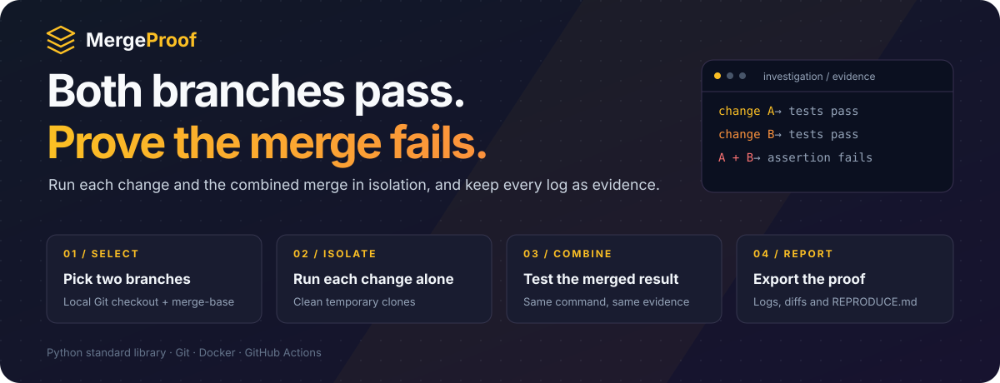
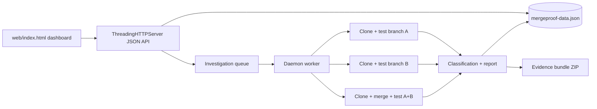

<p align="center">
  
</p>

<p align="center">
  <strong>Evidence-first Git integration investigations.</strong><br />
  Find the bugs that only appear when two individually passing changes are merged, and keep the proof.
</p>

<p align="center">
  <a href="https://github.com/Lingu17/MergeProof/actions/workflows/rebuild.yml"></a>
  
  
  
  
</p>

<p align="center">
  <a href="#the-product">Product</a> ·
  <a href="#engineering-decisions">Engineering</a> ·
  <a href="#architecture">Architecture</a> ·
  <a href="#verification">Verification</a> ·
  <a href="#run-locally">Run locally</a> ·
  <a href="#creator">Creator</a>
</p>

---

## The product

Change A passes its tests. Change B passes its tests. Merge them, and something breaks: a renamed key, a changed default, an assumption that only one side knew about. Code review rarely catches it, because each diff looks correct on its own.

**MergeProof runs each change and the combined merge in clean, isolated clones, then records exactly what happened.** It reports a confirmed interaction only when both independent runs pass and the combined run fails with real assertion evidence. Everything else is labeled for what it is.

| Capability | What you can do |
| :--- | :--- |
| **Repository import** | Validate and store a local Git checkout, list its branches, and inspect the `merge-base` of any two. |
| **Isolated execution** | Run your test command on branch A, branch B and the combined merge, each in its own temporary clone at an exact commit SHA. |
| **Honest classification** | Separate assertion failures from syntax errors, missing dependencies, timeouts, merge conflicts and other execution errors. |
| **Background investigations** | Queue an investigation, follow its progress, and cancel it cooperatively without marking it failed. |
| **Evidence bundle** | Download a ZIP with the JSON report, full logs, source diffs and a `REPRODUCE.md` with the exact commands. |
| **Dashboard** | A local web UI with live counts, recent activity, investigation history and a clearly labeled sample repository. |

### A workflow you can follow

**Select two branches → run each alone → run the merge → classify → export the proof**

## Engineering decisions

| Engineering problem | Implementation | Inspect the code |
| :--- | :--- | :--- |
| A failing exit code is not proof of a broken test | Only assertion tracebacks, pytest `assert` failures or unittest's failure summary count as `test_failure`. Syntax, import and other errors are classified separately. | [`classify_failure`](app.py#L274) |
| A merge conflict must never look like a confirmed bug | `summary.confirmed` requires tests to run in all three roles, A and B to pass, and the combined run to fail with a test failure and a log. | [`_confirmed`](app.py#L399) |
| Runs must not leak state into each other | Every role gets a fresh `git clone --no-local --no-hardlinks`; remote-only commits are fetched into private refs and executed by SHA. | [`_clone`](app.py#L301), [`run_branch`](app.py#L322), [`run_combined`](app.py#L340) |
| Long or stuck test suites | Commands run with a deadline and poll a cancel event, so timeouts and user cancellations end cleanly with their own status. | [`run_command`](app.py#L235) |
| Investigations should not block the UI | A single daemon worker thread consumes a queue and persists progress after each role. | [`InvestigationWorker`](app.py#L530) |
| Results need to be reproducible by someone else | The report, logs, diffs and reproduction steps are packed into one downloadable bundle. | [`evidence_bundle`](app.py#L53) |

MergeProof does **not** include runtime AI reasoning. Git and test evidence stay deterministic; an AI layer could later propose hypotheses or targeted regression tests whose claims remain unverified until executed.

## Architecture



- **Backend:** one Python file ([`app.py`](app.py)) using only the standard library: `http.server`, `subprocess`, `threading`, `zipfile`.
- **Frontend:** a single static page ([`web/index.html`](web/index.html)) served by the same process.
- **Storage:** a local JSON file (`mergeproof-data.json`, or `MERGEPROOF_DATA_FILE`). A labeled `checkout-service (sample)` record is created with every new store.
- **Fixture:** [`demo_repo/`](demo_repo) holds `change_a`, `change_b` and `combined` versions of a small service that reproduce a real interaction.

## Verification

| Gate | Evidence |
| :--- | :--- |
| Regression suite | **20 tests passed** locally (`python -m unittest discover -s tests`) |
| Linux rebuild | The [rebuild workflow](https://github.com/Lingu17/MergeProof/actions/workflows/rebuild.yml) builds the image on Ubuntu, runs the suite with `--network none` and no personal Git config, then checks `/api/health` on a running container. |
| Sample investigation | Change A and Change B pass independently; the combined snapshot reproduces a failing assertion. The fixture is *meant* to fail inside its investigation, while the suite itself exits with `OK`. |

<details>
<summary><strong>Scope and known limitations</strong></summary>

- Local-only application: no hosted accounts, billing, teams or remote provider imports. Repository import means a path to a local Git checkout.
- Repository tests execute code with the privileges of the process or container. Only run trusted repositories.
- Hosted multi-user execution is out of scope for this prototype.
- A documented Dockerfile alone is not proof of a successful run; check the workflow result for the commit you are using.

</details>

## Run locally

### Requirements

- Python **3.11.17**, pinned in `.python-version` and the Docker image.
- Git on your `PATH`. No personal Git identity is needed for temporary executions.
- Docker Engine or Desktop for the clean Linux rebuild.

There are no third-party Python packages. `requirements.lock` is intentionally empty apart from comments; it locks the complete dependency set.

```bash
git clone https://github.com/Lingu17/MergeProof.git
cd MergeProof
python -m pip install --no-index --require-hashes -r requirements.lock
python app.py
```

Open [http://localhost:8000](http://localhost:8000). The dashboard runs a real Python fixture analysis right away.

The server binds to `127.0.0.1` by default. Optional settings are documented in [`.env.example`](.env.example); the app reads environment variables, not `.env` files. In Bash: `cp .env.example .env`, then `set -a; . ./.env; set +a`. In PowerShell, set variables individually, for example `$env:MERGEPROOF_PORT = '8765'`.

| Variable | Purpose |
| :--- | :--- |
| `MERGEPROOF_PORT` | HTTP port (default `8000`) |
| `MERGEPROOF_BIND_HOST` | Interface to bind (default `127.0.0.1`) |
| `MERGEPROOF_DATA_FILE` | JSON store location (default `mergeproof-data.json` beside `app.py`) |

### Docker

```bash
docker build -t mergeproof .
docker run --rm -p 127.0.0.1:8000:8000 -v mergeproof-data:/data mergeproof
```

The named volume keeps investigations when the container is recreated; container data lives at `/data/mergeproof-data.json`. To analyze a host repository, mount it read-only and use the mounted path in the Repositories screen:

```bash
docker run --rm -p 127.0.0.1:8000:8000 \
  -v "$PWD/my-repository:/repos/my-repository:ro" \
  -v mergeproof-data:/data \
  mergeproof
```

Run the offline regression suite inside the image:

```bash
docker run --rm --network none -e GIT_CONFIG_GLOBAL=/dev/null -e GIT_CONFIG_NOSYSTEM=1 mergeproof python -m unittest discover -s tests -v
```

## API

All request and response bodies are JSON.

| Area | Routes |
| :--- | :--- |
| Health & overview | `GET /api/health`, `GET /api/overview` |
| Repositories | `GET` / `POST /api/repositories`, `POST /api/repositories/validate`, `GET /api/repositories/:id/inspect?branch_a=…&branch_b=…` |
| Investigations | `GET` / `POST /api/investigations`, `GET /api/investigations/:id` |
| Execution | `POST /api/investigations/:id/start`, `POST /api/investigations/:id/cancel` |
| Evidence | `GET /api/investigations/:id/runs`, `/history`, `/progress`, `/report` |
| Downloads | `GET /api/reports/:id/download` (JSON), `GET /api/reports/:id/bundle` (ZIP) |
| Sample | `GET /api/analysis` runs the bundled fixture |

`POST /api/investigations` accepts `repository_id`, `branch_a`, `branch_b` and an optional `test_command` (default `python -m unittest discover -v`).

## Demo outline

1. Open the `checkout-service (sample)` repository and create the `change_a` + `change_b` comparison.
2. Review the base/change/combined table, then start the background analysis.
3. See two passing independent checks and the combined assertion failure; open the saved diff and logs.
4. Download the evidence bundle and open `REPRODUCE.md`.
5. Add a real local Git repository, pick two branches and a test command, and repeat. The same engine reports an all-green result, a confirmed interaction, or a setup/merge/runtime result without conflating them.

## Project map

```text
MergeProof/
├── app.py                     HTTP API, Git execution, classification, worker, evidence bundle
├── web/index.html             Single-page dashboard
├── demo_repo/                 change_a, change_b and combined fixture versions
├── tests/
│   ├── test_analysis.py       Fixture analysis regression
│   └── test_backend.py        API, store, execution and classification tests
├── Dockerfile                 Pinned Python image with Git
├── requirements.lock          Empty, hash-locked dependency set
├── .env.example               Optional settings
└── .github/workflows/rebuild.yml  Linux rebuild, offline tests and health check
```

## Creator

**Lingraj Malipatil** · [GitHub @Lingu17](https://github.com/Lingu17) · [LinkedIn](https://www.linkedin.com/in/lingraj-malipatil-a2735a241/)

Released under the [MIT License](LICENSE). For a technical walkthrough, start with [`classify_failure`](app.py#L274), [`_confirmed`](app.py#L399) and the [backend tests](tests/test_backend.py).

---

<p align="center"><strong>MergeProof</strong><br />Two green builds are not a green merge. Prove it.</p>
